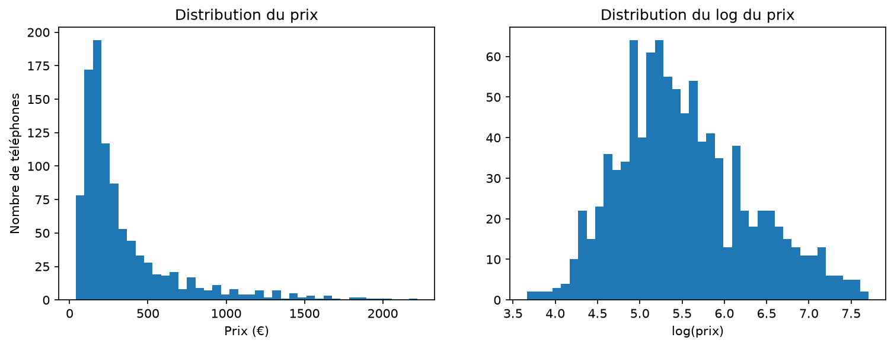
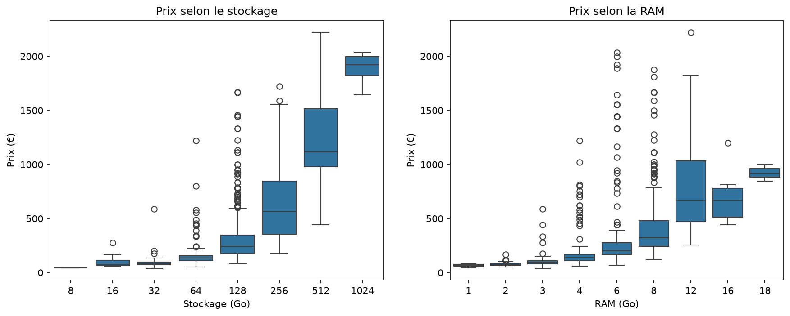
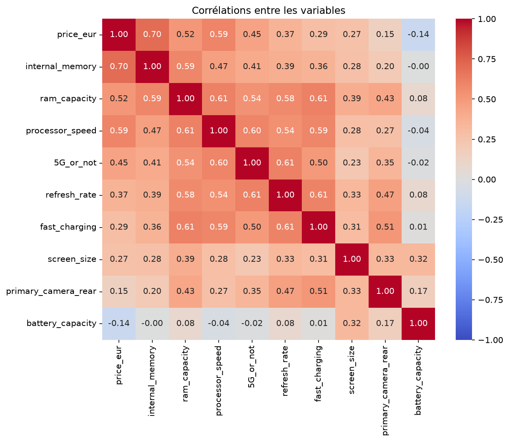
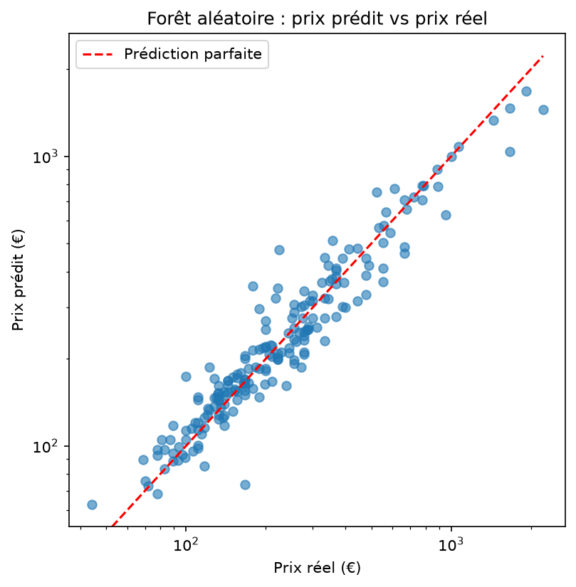
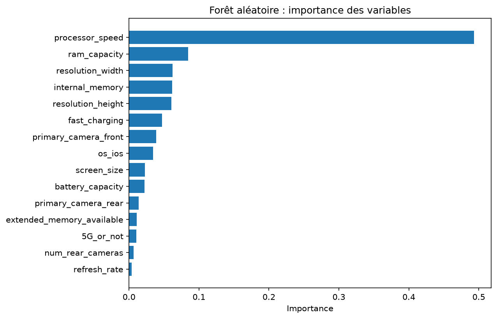
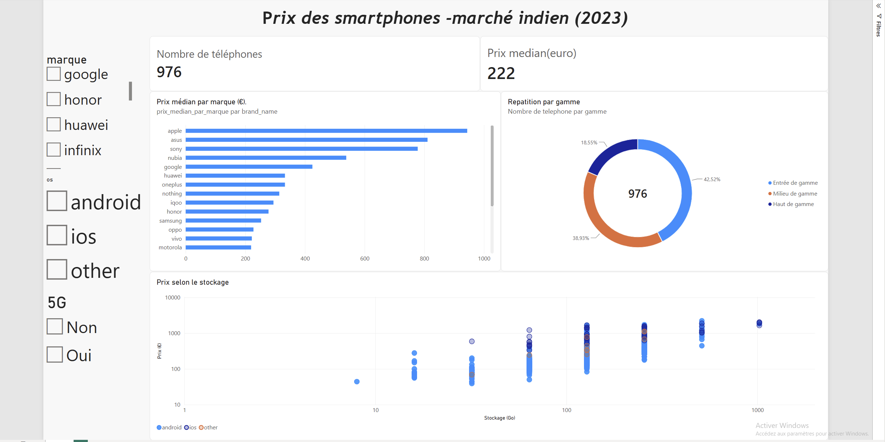

# Smartphone Price Prediction

**Which technical features drive the price of a smartphone, and can we predict that price from them?**

End-to-end data project: data cleaning with Pandas, exploratory analysis with Matplotlib and Seaborn, price prediction with Scikit-learn (linear regression and random forest), and an interactive Power BI dashboard.

**Main result:** the random forest predicts the price of a phone it has never seen **within 48 € on average**, with a **median error of 10.8 %**.

## Data

- **Source:** "Real-World Smartphone's Dataset" by Abhijit Dahatonde (Kaggle)
- **Size:** 980 smartphones, 22 columns, 46 brands, no duplicates
- **Market:** India, prices in Indian rupees (₹). The file has no date column; the most recent models it lists (Galaxy S23, iPhone 15) place the prices around **2023**.
- **Currency:** all results are shown in euros, using a fixed rate of **90 ₹ = 1 €**, close to the 2023 average.

## Data cleaning

The cleaned dataset (`data/smartphones_clean.csv`) has **976 phones, 22 columns and no missing values**. The raw file is never modified.

| Issue | Decision | Why |
| --- | --- | --- |
| Fast-charging power missing (211) | 0 W for the 143 phones without fast charging; median of phones with fast charging (33 W) for the other 68 | 0 W is the true value; the median is computed without those zeros to avoid bias |
| Average rating missing (101) | Column dropped | A customer rating cannot be invented, and a new phone has no rating yet |
| Other numeric columns (< 5 % missing) | Median | Robust to extreme values |
| Processor brand, OS | Most frequent value | No median for text |
| 4 luxury phones (Vertu, Porsche Design, gold edition) | Removed | Their price comes from luxury materials or branding, not from their specs |
| 24 brands with fewer than 5 phones | Grouped as "autre" (other) | Too few examples to learn from; 22 brand categories remain |

Dropping every incomplete row was rejected: it would have removed 211 phones (21 %), including 42 of the 46 iPhones, and missing values were concentrated on expensive phones, which would have biased the data toward entry-level models.

## Main findings



Prices are strongly right-skewed (median 222 €, mean 345 €). Their logarithm is almost symmetric, so the models predict **log(price)**.



- **Storage is the feature most correlated with price (0.70).** Above 64 GB, the median price roughly doubles each time storage doubles (133 € at 64 GB, 1,922 € at 1 TB).
- **RAM is less clear-cut:** iPhones combine only 6 GB of RAM with high prices, because RAM plays a different role on iOS and Android.
- **5G phones** have a median price of 333 €, versus 139 € without 5G, but 5G mostly signals newer, better-equipped phones (correlation, not causation).
- **Battery capacity is slightly negatively correlated with price (−0.14):** iPhones have small batteries, while budget Android phones compete on large batteries.



Removing the 4 luxury phones raised the storage–price correlation from 0.56 to 0.70.

## Models

80/20 train/test split (780 / 196 phones, `random_state=42`), target = log(price), brand, processor and OS one-hot encoded (51 features). Errors are computed in euros after converting predictions back with `exp`.

| Model | MAE (€) | R² (log price) | Median error |
| --- | --- | --- | --- |
| Linear regression (baseline) | 68 | 0.844 | 15.1 % |
| **Random forest** (300 trees) | **48** | **0.917** | **10.8 %** |

The random forest cuts the average error by about 30 %, because it captures interactions a linear model cannot (for example, RAM does not mean the same thing on iOS and Android). Its MAE varies between 47 and 49 € depending on the random seed.



Predictions follow the actual price across the whole range, with a stable relative error. Phones above 1,000 € are underestimated: a random forest averages the examples it has seen and cannot go beyond the extremes of the training data, where very expensive phones are rare.



Processor speed carries about half of the importance, followed by RAM, screen resolution and storage. These features are strongly correlated with each other, so importances should be read as a group ("overall hardware level") rather than as an exact ranking.

## Power BI dashboard



One interactive page (`dashboard/smartphones.pbix`) built from `data/smartphones_powerbi.csv`, created by `05_export_powerbi.py`:

- key figures: 976 phones, median price 222 €;
- median price by brand (from Apple, about 945 €, to Itel, about 65 €);
- price segments: entry-level (< 200 €, 42.5 %), mid-range (200–500 €, 38.9 %), high-end (> 500 €, 18.5 %);
- price vs storage, one point per phone, coloured by OS;
- filters by brand, OS and 5G that apply to every visual.

## Limitations

- Indian market around 2023: results do not transfer as-is to other markets.
- No release date, materials or brand image in the data, which explains part of the remaining error.
- A single train/test split; cross-validation would give a more robust estimate.

## Full report

A detailed report in French is available in [`rapport.pdf`](rapport.pdf).

## How to run

```bash
git clone https://github.com/ademejb/smartphone-price-prediction.git
cd smartphone-price-prediction
python3 -m venv .venv
source .venv/bin/activate
pip install -r requirements.txt

python3 scripts/01_exploration.py
python3 scripts/02_nettoyage.py
python3 scripts/03_visualisations.py
python3 scripts/04_modeles.py
python3 scripts/05_export_powerbi.py
```

The dashboard opens with Power BI Desktop (Windows).

## Project structure

```
smartphone-price-prediction/
├── data/          raw data, cleaned data, Power BI export
├── scripts/       01 to 05, run in order
├── figures/       charts produced by scripts 03 and 04
├── dashboard/     Power BI file and screenshot
├── rapport.pdf    full report (French)
└── requirements.txt
```

## Tools

Python 3.12 · Pandas · NumPy · Matplotlib · Seaborn · Scikit-learn · Power BI Desktop · VS Code

Project carried out in collaboration by Adem Ejebli ([@ademejb](https://github.com/ademejb)) and Ilian Ikdoumi ([@ikdoumi-Ilian](https://github.com/Ikdoumi-Ilian)).
